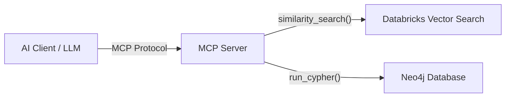

# Building MCP Tools for Databricks Vector Search and Neo4j

This guide provides a comprehensive overview of how to build Model Context Protocol (MCP) tools that enable Large Language Models (LLMs) to interact with **Databricks Vector Search** and **Neo4j Graph Databases**.

## Table of Contents
1. [Introduction to MCP](#introduction-to-mcp)
2. [Prerequisites](#prerequisites)
3. [Tool 1: Databricks Vector Search](#tool-1-databricks-vector-search)
   - [Capabilities](#capabilities)
   - [Tool Definition](#tool-definition-query_vector_index)
4. [Tool 2: Neo4j Graph Database](#tool-2-neo4j-graph-database)
   - [The Schema Discovery Problem](#the-schema-discovery-problem)
   - [Tool A: Get Graph Schema](#tool-a-get_graph_schema)
   - [Tool B: Execute Cypher Query](#tool-b-execute_cypher_query)
5. [Server Architecture](#server-architecture)
6. [Next Steps](#next-steps)

---

## Introduction to MCP

The **Model Context Protocol (MCP)** is a standard way for AI assistants and LLMs to connect to external data and tools. By running an MCP server, you expose local or remote resources (like databases) as "tools" that the LLM can invoke.

In this guide, we will design tools that allow an LLM to:
1.  Perform semantic/similarity searches on unstructured data using **Databricks Vector Search**.
2.  Navigate and query structured relationships using **Neo4j**.

## Prerequisites

To build and run these tools, you will need:
-   **Python 3.10+**
-   **Databricks Workspace**: With Vector Search enabled and an active Index.
-   **Neo4j Instance**: AuraDB (Cloud) or Community/Enterprise (Self-hosted).
-   **API Keys**:
    -   Databricks Host URL & Personal Access Token.
    -   Neo4j URI, Username, & Password.

---

## Tool 1: Databricks Vector Search

Databricks Vector Search is a serverless vector database that allows you to store embeddings (vector representations of text/images) and search for similar items. This is the backbone of RAG (Retrieval Augmented Generation).

### Capabilities

We will expose a single, powerful tool to the LLM: `query_vector_index`. This tool allows the LLM to find relevant documents based on user queries.

### Tool Definition: `query_vector_index`

**Purpose**: Retrieve information relevant to a natural language query.

**Inputs**:
*   `query_text` (string, required): The natural language question or keywords to search for.
*   `num_results` (integer, optional): The number of documents to retrieve (default: 5).
*   `filters` (dictionary, optional): Metadata filters to narrow down the search (e.g., `{"category": "finance"}`).

**Logic**:
1.  The LLM calls this tool with a query like "What is the policy on remote work?".
2.  The tool connects to the Databricks Vector Search Index.
3.  It performs a `similarity_search`.
4.  It returns a list of text chunks and their associated metadata.

---

## Tool 2: Neo4j Graph Database

Neo4j is a graph database that excels at managing complex relationships between entities. Querying a graph database is different from a vector database because it requires a precise query language: **Cypher**.

### The Schema Discovery Problem

LLMs are excellent at writing Cypher queries, but they **cannot** write a correct query if they don't know your specific graph schema (i.e., what Node Labels, Relationship Types, and Properties exist).

Therefore, we need a **two-step workflow**:

### Tool A: `get_graph_schema`

**Purpose**: specific tool to "look around" and understand the database structure before trying to query it.

**Inputs**: None (or optional filters for specific labels).

**Logic**:
1.  Runs a query to fetch all unique node labels, relationship types, and their property keys.
2.  Returns a text summary (e.g., "Nodes: [Person {name, age}, Movie {title}]. Relationships: (:Person)-[:ACTED_IN]->(:Movie)").

### Tool B: `execute_cypher_query`

**Purpose**: Run a specific, read-only query to get data.

**Inputs**:
*   `query` (string, required): The Cypher query to execute.
*   `params` (dictionary, optional): Parameters for the query.

**Logic**:
1.  Validates the query (basic check to prevent WRITE operations if desired).
2.  Executes the query against Neo4j.
3.  Returns the results as a JSON-like structure.

**The Workflow**:
1.  **User**: "Who acted in movies directed by Christopher Nolan?"
2.  **LLM**: "I need to know the schema first." -> Calls `get_graph_schema`.
3.  **Tool**: Returns schema showing `Person`, `Movie`, `DIRECTED`, `ACTED_IN`.
4.  **LLM**: "Okay, I see the structure." -> Calls `execute_cypher_query` with `MATCH (p:Person)-[:DIRECTED]->(m:Movie)<-[:ACTED_IN]-(actor:Person) WHERE p.name = 'Christopher Nolan' RETURN actor.name`.
5.  **Tool**: Returns list of actors.

---

## Server Architecture

We will implement a single Python MCP server that hosts all three tools.

### Required Packages
*   `mcp`: The official Python SDK for Model Context Protocol.
*   `databricks-vectorsearch`: SDK for Databricks.
*   `neo4j`: Official Python driver for Neo4j.

---

## Next Steps

Proceed to the **[Starter Code](MCP_TOOLS_STARTER_CODE.md)** file to see the complete implementation of this architecture, including:
1.  Environment setup (`requirements.txt`).
2.  `server.py` implementation.
3.  Configuration instructions.
